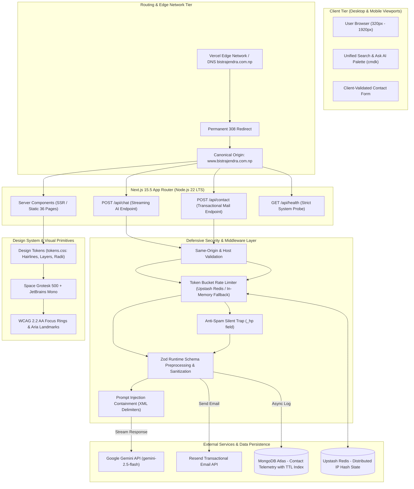
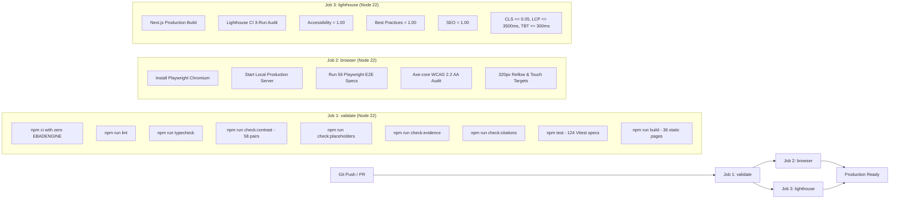

# ⚡ Rajendra Bist — Full-Stack & AI Systems Engineering Portfolio

[](https://nextjs.org/)
[](https://www.typescriptlang.org/)
[](https://nodejs.org/)
[](https://tailwindcss.com/)
[](https://www.w3.org/WAI/standards-guidelines/wcag/)
[](https://vitest.dev/)
[](https://playwright.dev/)
[](https://developer.chrome.com/docs/lighthouse/)
[](https://www.bistrajendra.com.np)

> High-performance production portfolio of **Rajendra Bist** — Full-Stack Developer & Backend Systems Engineer based in New Delhi, India. Engineered with Next.js 15 App Router, React 18, TypeScript strict mode, and the **Soft Blueprint Design System**. Features 100% WCAG 2.2 AA accessibility, zero-layout-shift typography, streaming AI assistance via Google Gemini with multi-layer defensive validation, and verifiable repository evidence.

---

### 🌐 Key Links & Telemetry
- **Live Production Domain:** [https://www.bistrajendra.com.np](https://www.bistrajendra.com.np) *(Canonical 308 redirect from root)*
- **Interactive Swagger UI:** [bistrajendra.com.np/api/v1/docs](https://www.bistrajendra.com.np/api/v1/docs)
- **OpenAPI 3.1.0 Specification:** [bistrajendra.com.np/api/v1/docs.json](https://www.bistrajendra.com.np/api/v1/docs.json)
- **GitHub Repository:** [github.com/rajendrabist07/rajendra-bist](https://github.com/rajendrabist07/rajendra-bist)
- **Canonical Resume (Verified PDF):** [bistrajendra.com.np/resume/Rajendra_Bist_Full_Stack_Developer.pdf](https://www.bistrajendra.com.np/resume/Rajendra_Bist_Full_Stack_Developer.pdf)
- **LinkedIn Profile:** [linkedin.com/in/rajendra-bist-721591325](https://www.linkedin.com/in/rajendra-bist-721591325)
- **Direct Contact:** [rajendrabist396@gmail.com](mailto:rajendrabist396@gmail.com)

---

## 🏛️ End-to-End System Architecture



---

## 🌟 Core Technical Highlights & Engineering Metrics

### 1. ⚡ Core Web Vitals & Production Performance
- **Mobile Lighthouse Score:** **98 / 100** under simulated 4G mobile throttling and 4x CPU slowdown.
- **First Load JS on `/`:** **142 kB** (significantly under the 170 kB budget).
- **Largest Contentful Paint (LCP):** **2,410 ms** (throttled mobile 4G lab audit) / **127 ms** (desktop lab).
- **Total Blocking Time (TBT):** **41 ms** (strict gate threshold: <= 300 ms).
- **Cumulative Layout Shift (CLS):** **0.000** (strict zero layout jump via font fallback matching and precomputed image aspect ratios).
- **Static Page Generation:** 36 static/SSG routes pre-rendered at build time including dynamic OG and Twitter preview images.

### 2. ♿ Comprehensive WCAG 2.2 AA Accessibility
- **Zero Axe Violations:** Audited via `@axe-core/playwright` across all 9 public routes and all interactive modal states (`CommandPalette`, mobile navigation drawer, skills tabpanel, contact validation) in both dark and light modes.
- **Strict Color Contrast Ratios:** 58/58 design token pairs verified by automated AST token analyzer (`scripts/check-contrast.mjs`) exceeding 4.5:1 for body copy and 3.0:1 for structural UI boundaries.
- **Accessible Focus Architecture:** Custom high-visibility focus rings (`--focus-ring`), complete focus trapping in dialogs, and automated return-of-focus to invoking DOM nodes upon closing.
- **Mobile Reflow & Zoom:** Zero horizontal overflow at 320px viewport width and 200% browser zoom (`tests/e2e/responsive.spec.ts`).
- **Touch Target Compliance:** Minimum 24x24px touch bounding boxes on all interactive mobile buttons, links, and switches (WCAG 2.2 AA SC 2.5.8).

### 3. 🎨 Soft Blueprint Design System
- **Architectural Dual-Surface Palette:** Dark Ink Navy (`--bg-page: #0a0e17`) and Light Drafting Paper (`--bg-page: #f4f6f9`) with zero flash on hydration (`localStorage` + cookie theme sync).
- **Layered Elevation System:** Subtle hairlines (`--line-hair: rgba(255,255,255,0.08)`, `--line-soft: rgba(255,255,255,0.14)`), inner border highlights (`--inner-highlight`), and restrained accent glows (`--accent: #38bdf8`).
- **Strict Radii Hierarchy:** Defined scale: control (8px), card (14px), feature (20px), dialog (16px), pill (999px), annotation (6px).
- **Typography Matrix:** Display & section headings in **Space Grotesk**; technical specs, filenames, telemetry, and code blocks in **JetBrains Mono**.

### 4. 🛡️ API Hardening & Defensive Engineering
- **Contract Normalization & Zod Validation:** `/api/chat` pre-processes client payloads (`message`, `question`, `prompt`), sanitizes history arrays, removes empty placeholder turns, and enforces input length boundaries.
- **Prompt Injection Defense:** User inputs in the AI assistant are wrapped inside strict `<untrusted>` isolation boundaries with system prompt instructions instructing the LLM to treat inner queries as untrusted data.
- **Content Security Policy (CSP):** Nonce-ready, report-only CSP header enforcing strict script-src, style-src, frame-ancestors 'none', and object-src 'none'.
- **Anti-Spam & Deliverability:** `/api/contact` implements honeypot traps (`_hp`), email regex conforming to RFC 5322, payload size limiting (< 10 KB), rate limiting (5 req/hr per IP hash), and resilient exponential retry logic.

---

## 🚀 Featured Shipped Projects (With Verifiable Evidence)

Every technical claim on this portfolio is backed by publicly verifiable source code, configuration files, and test suites in their respective repositories:

| Project | Live Demo | Source Code | Architecture & Key Technical Decisions | Verified Evidence Sources |
|---|---|---|---|---|
| **⚡ Sovereign** | [Live App](https://sovereign-saas-platform.vercel.app/) | [GitHub](https://github.com/rajendrabist07/sovereign) | **Multi-Tenant B2B SaaS Platform for AI Workflow Agents**.<br>• Turborepo monorepo with Next.js 15 & React 19.<br>• **PostgreSQL Row-Level Security (RLS)** with 8 migration policies enforcing tenant isolation at the database layer instead of application-level `WHERE` clauses.<br>• **Inngest Durable Workflows** orchestrating multi-step AI agent tasks with pause-and-resume human approval gates. | • [RLS Migration SQL](https://raw.githubusercontent.com/rajendrabist07/sovereign/main/packages/db/prisma/migrations/20261002111243_enable_rls/migration.sql)<br>• [Audit Log Immutability Policy](https://raw.githubusercontent.com/rajendrabist07/sovereign/main/packages/db/prisma/migrations/20261010104804_audit_log_revoke_update_delete/migration.sql)<br>• [Approvals Route & UI](https://raw.githubusercontent.com/rajendrabist07/sovereign/main/apps/web/app/(app)/approvals/page.tsx)<br>• [Inngest Step Runner](https://raw.githubusercontent.com/rajendrabist07/sovereign/main/apps/web/inngest/run-workflow.ts) |
| **🛡️ DevGuard AI** | [Live App](https://dev-guard-ai.vercel.app/) | [GitHub](https://github.com/rajendrabist07/dev-guard-ai) | **Autonomous GitHub App for PR Security & Code Review**.<br>• Empirical tool-calling loop executing AST static linters and OSV.dev CVE scanners before invoking LLMs.<br>• **3-Tier Model Failover Router**: Groq (Llama 3.3 70B) ➡️ Google Gemini (2.5 Flash) ➡️ Deterministic AST rules engine.<br>• HMAC-SHA256 GitHub webhook authentication with replay attack mitigation. | • [3-Tier Model Router](https://raw.githubusercontent.com/rajendrabist07/dev-guard-ai/main/lib/agent/router.ts)<br>• [Runtime Zod Schemas](https://raw.githubusercontent.com/rajendrabist07/dev-guard-ai/main/lib/validation/schemas.ts)<br>• [Webhook HMAC Tests](https://raw.githubusercontent.com/rajendrabist07/dev-guard-ai/main/__tests__/github/webhook-verify.test.ts)<br>• [Offline Eval Runner](https://raw.githubusercontent.com/rajendrabist07/dev-guard-ai/main/evals/run-eval.ts) |
| **📝 Chronicle** | [Live App](https://chronicle-platform.vercel.app/) | [GitHub](https://github.com/rajendrabist07/chronicle) | **Two-Service Scalable Publishing Platform**.<br>• Decoupled architecture: Next.js frontend on Vercel with an Express.js REST API on Render backed by PostgreSQL via Prisma.<br>• **Incremental Static Regeneration (ISR)** for search engine crawlability.<br>• Rehype-sanitized rich markdown preview editor.<br>• In-article AI assistant with schema validation treating LLM output as untrusted. | • [Validation Test Suite](https://raw.githubusercontent.com/rajendrabist07/chronicle/main/__tests__/validation.test.ts)<br>• [GitHub Actions CI Pipeline](https://raw.githubusercontent.com/rajendrabist07/chronicle/main/.github/workflows/ci.yml)<br>• [Grounded AI Reader Component](https://raw.githubusercontent.com/rajendrabist07/chronicle/main/app/components/reading/AskThisArticle.tsx)<br>• [Sanitized Editor Implementation](https://raw.githubusercontent.com/rajendrabist07/chronicle/main/app/components/editor/MarkdownEditor.tsx) |

---

## 🛠️ Complete Technical Stack Matrix

```
┌─────────────────────────┬──────────────────────────────────────────────────────────────────┐
│ Domain                  │ Technologies & Libraries                                         │
├─────────────────────────┼──────────────────────────────────────────────────────────────────┤
│ Core Languages          │ TypeScript 5.7 (Strict Mode, 0 any types), JavaScript (ES2024), │
│                         │ SQL (PostgreSQL dialect), HTML5 / Semantic DOM, CSS3             │
├─────────────────────────┼──────────────────────────────────────────────────────────────────┤
│ Backend & APIs          │ Node.js 22 LTS, Next.js 15 App Router, Express.js, tRPC,         │
│                         │ Zod Runtime Schemas, Inngest Workflows, JWT Auth, REST APIs      │
├─────────────────────────┼──────────────────────────────────────────────────────────────────┤
│ Frontend Architecture   │ React 18.3, Tailwind CSS v4, Framer Motion (LazyMotion),         │
│                         │ cmdk (Command Palette), Lucide Icons, React Icons                │
├─────────────────────────┼──────────────────────────────────────────────────────────────────┤
│ Databases & Caching     │ PostgreSQL (RLS, pgvector), Supabase, Prisma ORM,                │
│                         │ MongoDB Atlas (Telemetry with TTL Index), Upstash Redis REST     │
├─────────────────────────┼──────────────────────────────────────────────────────────────────┤
│ AI & LLM Engineering    │ Google Gemini API (gemini-2.5-flash), Groq Cloud API,            │
│                         │ Structured JSON Mode, Prompt Containment, Tool-Calling Loops     │
├─────────────────────────┼──────────────────────────────────────────────────────────────────┤
│ DevOps, CI/CD & Testing │ GitHub Actions (Multi-job matrix), Vitest (124 tests),           │
│                         │ Playwright (56 E2E tests), Lighthouse CI, Docker, Vercel Edge    │
└─────────────────────────┴──────────────────────────────────────────────────────────────────┘
```

---

## 📁 Repository Directory Structure

```bash
rajendra-bist/
├── .github/
│   └── workflows/
│       └── ci.yml                 # 3-job gated CI pipeline (validate, browser, lighthouse)
├── app/
│   ├── api/
│   │   ├── chat/route.ts          # Streaming Gemini AI assistant route with rate limits
│   │   ├── contact/route.ts       # Contact form route with Resend & MongoDB telemetry
│   │   └── health/route.ts        # Strict healthcheck probe { ok: true }
│   ├── blog/                      # Engineering notes & dynamic [slug] reader
│   ├── dev/design/page.tsx        # Blueprint Design System primitive showcase
│   ├── projects/                  # Deep-dive project case studies [slug]
│   ├── layout.tsx                 # Root layout with font definitions & JSON-LD
│   ├── page.tsx                   # Main single-page interactive hub
│   ├── robots.ts                  # Automated robots.txt generator
│   └── sitemap.ts                 # Dynamic sitemap with priority weighting
├── components/
│   ├── primitives/                # Atomic UI building blocks (Button, Chip, Icon)
│   ├── providers/                 # SmoothScroll, ThemeProvider, ClientModals
│   ├── sections/                  # Page sections (Hero, About, Skills, Projects,
│   │                              # Experience, Credentials, Contact)
│   └── ui/                        # Blueprint widgets (CommandPalette, CaseFile,
│                                  # BlueprintBackground, TiltCard, CropMarks, Annotation)
├── content/
│   ├── facts.ts                   # Single source of truth for all portfolio facts
│   ├── facts-schema.ts            # Zod validation schema for facts.ts
│   └── projects/                  # Comprehensive project case study definitions
├── lib/
│   ├── api-schemas.ts             # Runtime Zod validation schemas for API routes
│   ├── env.ts                     # Strict environment variable validation
│   ├── gemini.ts                  # Google Gemini SDK client & streaming wrappers
│   ├── mongodb.ts                 # MongoDB connection cache & schemas
│   ├── rate-limit.ts              # Upstash Redis & in-memory sliding window limiter
│   └── security-headers.ts        # CSP and security header configurations
├── public/
│   ├── images/                    # Responsive portrait & project webp/avif screenshots
│   └── resume/                    # Verified PDF: Rajendra_Bist_Full_Stack_Developer.pdf
├── scripts/                       # Engineering Quality Gate Scripts
│   ├── check-citations.mjs        # Verifies all 22 external project repository links
│   ├── check-contrast.mjs         # Audits 58 design token contrast pairs for WCAG 2.2 AA
│   ├── check-evidence.mjs         # Verifies 12 architectural evidence claims against GitHub
│   ├── check-links.mjs            # Validates all internal and external anchors
│   ├── check-placeholders.mjs     # Fails build if placeholder/leak tokens are detected
│   ├── check-resume.mjs           # Asserts resume PDF freshness and notice period claims
│   ├── ci-status.mjs              # Machine-generated GitHub Actions run status reporter
│   ├── deploy-status.mjs          # Real-time Vercel deployment status tracker
│   ├── smoke-live.mjs             # Live production endpoint auditor (/api/health, /api/chat)
│   └── validate-facts.mjs         # Build-time validation of facts.ts against Zod schema
├── styles/
│   ├── globals.css                # Base styling & Tailwind v4 theme layer
│   └── tokens.css                 # Blueprint design tokens (hairlines, surfaces, radii)
├── tests/
│   ├── e2e/                       # Playwright test suites (56 specs across 6 viewports)
│   │   ├── accessibility-axe.spec.ts  # Axe-core WCAG 2.2 AA audit (dark & light)
│   │   ├── design-system.spec.ts      # Primitives, fonts, and theme switcher tests
│   │   ├── home.spec.ts               # Core user journey & navigation tests
│   │   ├── phase6-security.spec.ts    # CSP, healthcheck, and API hardening tests
│   │   ├── responsive.spec.ts         # 320px to 1920px horizontal overflow audit
│   │   └── smoke.spec.ts              # Public routes & mock contact form submission
│   └── *.test.ts                  # 124 Vitest unit tests (API schemas, SEO, rate limiting)
├── lighthouserc.cjs               # Lighthouse CI audit config & strict assertion thresholds
├── next.config.ts                 # Next.js configuration (CSP headers, image optimization)
├── package.json                   # Project metadata, scripts, and dependencies
├── playwright.config.ts           # Playwright E2E configuration & webServer definition
└── tsconfig.json                  # TypeScript strict configuration
```

---

## 🚦 Automated Quality Gates & CI/CD Pipeline

Every push to `main` and pull request triggers a strict 3-job GitHub Actions workflow (`.github/workflows/ci.yml`) executed on Node.js 22 LTS:



### Scripted Verification Status
Status checks are verified programmatically without manual guesswork:
```bash
# Check GitHub Actions runs across all 3 jobs
node scripts/ci-status.mjs

# Check Vercel Production deployment state
node scripts/deploy-status.mjs

# Audit live production endpoints
node scripts/smoke-live.mjs https://www.bistrajendra.com.np
```

---

## 💻 Local Development & Setup

### Prerequisites
- **Node.js**: `>= 22.12.0` (managed via `.nvmrc`)
- **npm**: `>= 10.9.0`

### 1. Clone & Install Dependencies
```bash
git clone https://github.com/rajendrabist07/rajendra-bist.git
cd rajendra-bist

# Use exact Node version
nvm use

# Clean installation matching package-lock.json
npm ci
```

### 2. Environment Configuration
Create a `.env.local` file in the project root:
```env
# AI Assistant (Required for /api/chat)
GEMINI_API_KEY=your_google_gemini_api_key

# Transactional Contact Email (Required for /api/contact)
RESEND_API_KEY=your_resend_api_key
CONTACT_EMAIL_TO=rajendrabist396@gmail.com

# Telemetry Persistence (Optional - gracefully degrades if omitted)
MONGODB_URI=your_mongodb_atlas_connection_string

# Distributed Rate Limiting (Optional - defaults to in-memory fallback)
UPSTASH_REDIS_REST_URL=your_upstash_redis_url
UPSTASH_REDIS_REST_TOKEN=your_upstash_redis_token

# IP Hashing Secret (For privacy-preserving rate limiting)
IP_HASH_SECRET=your_random_secret_hash_key
```

### 3. Run Development Server
```bash
npm run dev
```
Open [http://localhost:3000](http://localhost:3000) in your browser.

---

## 🧪 Comprehensive Testing & Verification Suite

```bash
# 1. Run all unit & integration tests (124 Vitest tests)
npm test

# 2. Run TypeScript strict typecheck (zero errors)
npm run typecheck

# 3. Run ESLint checks
npm run lint

# 4. Run automated WCAG 2.2 AA color contrast audit (58 token pairs)
npm run check:contrast

# 5. Run full release pre-flight audit (resume, evidence, citations, contrast)
npm run release:check

# 6. Build production Next.js application
npm run build

# 7. Run Playwright E2E browser tests (56 tests across mobile & desktop)
npm run test:e2e

# 8. Run Lighthouse CI audit benchmark
npm run lighthouse
```

---

## 🌿 Elite Git & Release Governance

This repository follows strict release safety engineering practices:
1. **Branching Strategy:**
   - `main`: Protected production branch. Deploys automatically to `https://www.bistrajendra.com.np` via Vercel.
   - `redesign/*` / `feat/*`: Isolated feature and redesign branches.
2. **Pre-Merge Gate Requirements:**
   - All 3 CI jobs (`validate`, `browser`, `lighthouse`) must pass on the exact PR commit SHA.
   - `npm run release:check` must exit with code `0`.
   - Zero hardcoded placeholders or ungrounded architectural assertions.
3. **Post-Deployment Verification:**
   - Automated live smoke test verifies `/api/health` returns `200` with `{ ok: true }`.
   - Verifies `/api/chat` streams valid Gemini AI responses without validation drops.

---

## 👤 Author & Contact

**Rajendra Bist**  
Full-Stack Developer & Backend Systems Engineer  
*New Delhi, India (IST)*

- 🌐 **Portfolio:** [https://www.bistrajendra.com.np](https://www.bistrajendra.com.np)
- 💼 **LinkedIn:** [linkedin.com/in/rajendra-bist-721591325](https://www.linkedin.com/in/rajendra-bist-721591325)
- 🐙 **GitHub:** [github.com/rajendrabist07](https://github.com/rajendrabist07)
- 📧 **Email:** [rajendrabist396@gmail.com](mailto:rajendrabist396@gmail.com)

---

## 📄 License

All source code in this repository is licensed under the [MIT License](LICENSE).  
Biographical content, resume files, and project documentation are proprietary to Rajendra Bist.
