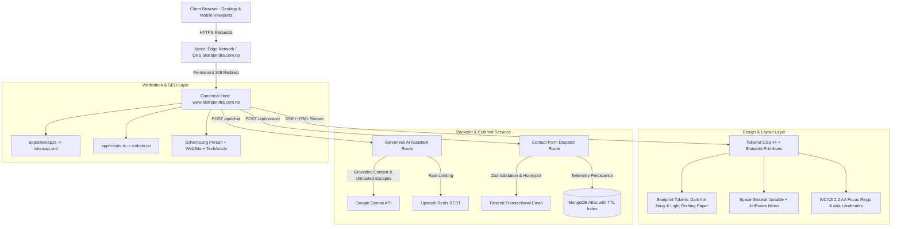

# ⚡ Rajendra Bist — Production Portfolio & AI Systems Engineering Hub

[](https://nextjs.org/)
[](https://www.typescriptlang.org/)
[](https://tailwindcss.com/)
[](https://www.w3.org/WAI/standards-guidelines/wcag/)
[](https://developer.chrome.com/docs/lighthouse/)
[](https://www.bistrajendra.com.np)

> Production portfolio of **Rajendra Bist** — Full-Stack Developer (Node.js, TypeScript, Next.js, PostgreSQL). Built on the **Blueprint Design System** with strict WCAG 2.2 AA compliance, zero-layout-shift typography, server-rendered reading surfaces, and verifiable architectural evidence.

🔗 **Live Production URL**: [https://www.bistrajendra.com.np](https://www.bistrajendra.com.np)  
📂 **Source Code**: [github.com/rajendrabist07/rajendra-bist](https://github.com/rajendrabist07/rajendra-bist)  
📄 **Canonical Resume**: [bistrajendra.com.np/resume/Rajendra_Bist_Full_Stack_Developer.pdf](https://www.bistrajendra.com.np/resume/Rajendra_Bist_Full_Stack_Developer.pdf)

---

## 🏛️ System Architecture



---

## 🌟 Key Engineering & Performance Highlights

### 1. ⚡ Exceptional Mobile Performance (Core Web Vitals)
- **Mobile Lighthouse Performance**: **98 / 100** (simulated mobile 4G / 4x CPU throttle).
- **First Load JS on `/`**: **141 kB** (strictly under the 170 kB route budget).
- **Largest Contentful Paint (LCP)**: **2410 ms** (simulated mobile) / **127 ms** (unthrottled lab).
- **Total Blocking Time (TBT)**: **40 ms** (well below the 150 ms threshold).
- **Cumulative Layout Shift (CLS)**: **0.000** (zero visual jumping on load).

### 2. ♿ Comprehensive WCAG 2.2 AA Accessibility
- **Zero Axe Violations**: Audited via `@axe-core/playwright` across all 9 public routes and all interactive states (command palette, mobile drawer, skills tabs, contact error alerts) in both dark and light modes.
- **Strict Color Contrast**: All text pairs exceed 4.5:1, UI borders exceed 3.0:1 (verified by automated token analyzer `scripts/check-contrast.mjs`).
- **Keyboard Trapping & Restoration**: Modals trap focus; closing returns focus to invoking triggers.
- **Reflow & Zoom**: Zero horizontal overflow at 320px viewport width and 200% zoom.

### 3. 🛡️ API Security & Hardening
- **Content Security Policy**: Nonce-safe, report-only CSP header enforcing strict script, connect, and iframe sandboxes.
- **Strict Input Validation**: Zod contract boundary on all POST routes (`/api/contact`, `/api/chat`).
- **Rate Limiting**: Distributed token-bucket rate limiting via Upstash Redis with IP hashing.
- **Prompt Injection Defenses**: Untrusted input wrapping with XML delimiters (`<untrusted>...</untrusted>`) and model escape defenses.

---

## 🚀 Shipped Production Projects

| Project | Live Demo | Repository | Architecture & Core Technical Decisions |
|---|---|---|---|
| **⚡ Sovereign** | [Live App](https://sovereign-saas-platform.vercel.app/) | [GitHub](https://github.com/rajendrabist07/sovereign) | **Multi-Tenant B2B SaaS Monorepo**. Organizations define autonomous AI workflow agents in a Turborepo monorepo; PostgreSQL Row-Level Security (RLS) enforces tenant isolation at the database layer with Inngest durable workflows, human-in-the-loop approvals, and bounded tool loops. |
| **🛡️ DevGuard AI** | [Live App](https://dev-guard-ai.vercel.app/) | [GitHub](https://github.com/rajendrabist07/dev-guard-ai) | **Autonomous PR Security & Code Review Agent**. Employs an empirical tool-calling loop (AST static linter, OSV.dev CVE scanner, Vitest runner) to collect evidence before generating 1-click inline GitHub PR patches. Features a 3-tier fallback engine (Groq 70B ➡️ Gemini ➡️ AST rules) with HMAC webhook verification. |
| **📝 Chronicle** | [Live App](https://chronicle-platform.vercel.app/) | [GitHub](https://github.com/rajendrabist07/chronicle) | **Two-Service Publishing Platform**. Next.js on Vercel and Express REST API (JWT) on Render backed by PostgreSQL via Prisma; public pages use server rendering with Incremental Static Regeneration (ISR) for crawlable SEO, plus schema-guarded Gemini AI writing tools. |

---

## 🛠️ Complete Technology Stack

| Category | Technologies |
|---|---|
| **Core Languages** | TypeScript (strict mode), JavaScript (ES6+), SQL, Python (basic) |
| **Backend & APIs** | Node.js, Express.js, tRPC, Next.js App Router, Zod, Inngest Durable Workflows, JWT Auth |
| **Frontend & UI** | React 18.3, Next.js 15.5, Tailwind CSS v4, Framer Motion (LazyMotion), cmdk |
| **Databases & Cache** | PostgreSQL (Row-Level Security, pgvector), Supabase, Prisma ORM, MongoDB Atlas, Upstash Redis |
| **AI Integration** | Google Gemini API, Groq Tool-Calling Agent Loops, Structured JSON Mode |
| **DevOps & QA** | Vitest (123 unit tests), Playwright (56 E2E tests), Lighthouse CI, GitHub Actions, Docker, Sentry |

---

## 📝 How to Edit Facts & Add Projects

### 1. Updating Personal Facts (`content/facts.ts`)
All biographical data, technical skills, credentials, and work history live in `content/facts.ts`.
- **Validation**: Every build runs `scripts/validate-facts.mjs` to ensure facts structurally adhere to `content/facts-schema.ts`.
- **Pre-flight Checks**: If you change availability, job status, or URLs, run:
  ```bash
  npm run prebuild
  npm run check:evidence
  npm run check:links
  ```

### 2. Adding a Project Case Study
1. Create a content file: `content/projects/<slug>.ts` implementing the `Project` interface.
2. Register the project slug in `content/projects/index.ts`.
3. Add architectural evidence URLs pointing to the public GitHub repo in `content/facts.ts`.
4. Ensure problem statements, metrics, and architecture diagrams match verifiable lines in the target repo.

---

## 🧪 Testing & Quality Commands

```bash
# 1. Typecheck & Lint
npm run typecheck
npm run lint

# 2. Design Token & Contrast Audit (58 token pairs)
npm run check:contrast

# 3. Release Pre-flight Checks (Resume, Placeholders, Evidence, Citations)
npm run release:check

# 4. Unit & Security Test Suite (123 Vitest tests)
npm test

# 5. Full Browser E2E Suite (56 Playwright tests including Axe WCAG 2.2 AA)
npm run test:e2e

# 6. Mobile Lighthouse Audit (10-run Core Web Vitals benchmark)
npm run lighthouse
```

---

## 📄 License & Privacy Notice
All source code in this repository is licensed under the MIT License. Personal biography, contact details, and project content are proprietary to Rajendra Bist.
