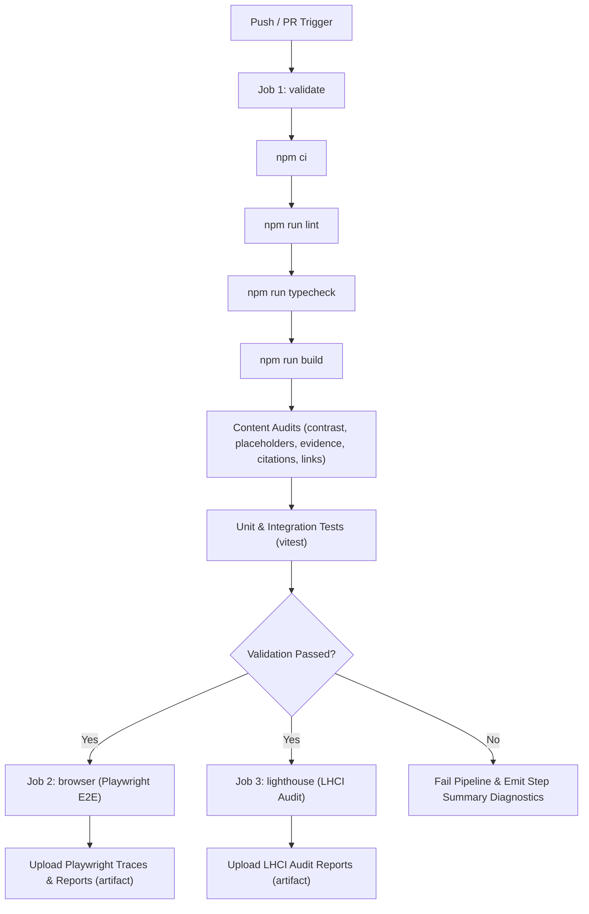

# Continuous Integration & Release Safety (CI/CD)

> **Repository:** `github.com/rajendrabist07/rajendra-bist`  
> **Target Release Branch:** `redesign/v4`  
> **Production Branch:** `main` (Protected)  
> **Workflow File:** `.github/workflows/ci.yml`

---

## 1. Pipeline Architecture Map

The CI workflow runs on GitHub Actions using `ubuntu-latest` runners configured with Node.js 22.x (from `.nvmrc`). It is organized into three sequential and gated jobs:



### Job Descriptions & Scope

| Job Name | Depends On | Execution Scope | Key Gates & Assertions |
|---|---|---|---|
| `validate` | None (Entry) | Linting, type-checking, production build, content truth checks, and unit tests | Fails on any ESLint error, TS type error, broken link, contrast defect, citation mismatch, or test assertion failure |
| `browser` | `validate` | End-to-end browser execution across desktop & mobile viewports | Full Playwright suite (`tests/e2e`), testing navigation, interactive modals, responsive layouts, and axe-core accessibility |
| `lighthouse` | `validate` | Mobile Core Web Vitals and quality audits | Accessibility = 1.0, Best Practices = 1.0, SEO = 1.0, CLS <= 0.05, Performance >= 0.85, LCP <= 3500ms, TBT <= 300ms |

---

## 2. Reading Failures & GitHub Actions Diagnostics

When a CI run fails, diagnosis is streamlined via three built-in mechanisms:

1. **Step Summaries (`$GITHUB_STEP_SUMMARY`)**:
   Every job includes an automated `if: failure()` step that posts an unedited markdown summary table directly to the run's overview page, highlighting the failing commit SHA and job name.
2. **Workflow Check Annotations (`::error::`)**:
   Failing steps emit inline annotations pointing to exact line numbers in PR diffs or logs.
3. **Artifact Retention**:
   - `playwright-report`: Uploaded automatically on every browser run (`if: always()`, retained 14 days), containing HTML test reports and interactive traces (`trace.zip`).
   - `lighthouse-report`: Uploaded automatically on every lighthouse run (`if: always()`, retained 14 days), containing complete LHCI JSON and HTML reports.

---

## 3. How to Reproduce Locally

### Automated Script
Run the automated local reproduction script:
```bash
bash scripts/ci-local.sh
```

> [!NOTE]
> If the Docker daemon is not running on the host, `scripts/ci-local.sh` automatically falls back to native execution using your local Node 22 environment.

### Direct Step-by-Step Commands
```bash
# 1. Clean reproducible dependency install
npm ci

# 2. Static analysis
npm run lint
npm run typecheck

# 3. Production build (required before SSR tests & servers)
npm run build

# 4. Content integrity checks
npm run check:contrast
npm run check:placeholders
npm run check:evidence
npm run check:citations
npm run check:links

# 5. Unit & integration tests with memory rate limiter
RATE_LIMIT_DRIVER=memory npm test

# 6. End-to-end browser tests
npx playwright test

# 7. Lighthouse CI audit
npm run lighthouse
```

---

## 4. CI Environment Variables & Secret Safety

The CI workflow uses non-secret dummy environment variables to ensure zero secret leakage and avoid calling live paid external APIs during test execution:

| Variable Name | CI Value | Purpose |
|---|---|---|
| `RATE_LIMIT_DRIVER` | `memory` | Directs rate limiter to use deterministic in-memory Map instead of Upstash Redis |
| `NEXT_TELEMETRY_DISABLED` | `1` | Disables Next.js build telemetry in CI |
| `GEMINI_API_KEY` | `ci-dummy-gemini-key` | Prevents runtime exceptions during static analysis; model calls are mocked |
| `RESEND_API_KEY` | `ci-dummy-resend-key` | Prevents live email dispatch during contact route tests |
| `IP_HASH_SECRET` | `ci-dummy-hash-secret` | Provides deterministic salt for SHA-256 IP hashing |

---

## 5. Troubleshooting & Root Cause Analysis

| Symptom / Error | Root Cause | Permanent Resolution |
|---|---|---|
| `npm ci` fails with `Missing: @emnapi/runtime` / `@emnapi/core` | Cross-platform optional dependencies omitted from lockfile on macOS generation | Locked `@emnapi/core` and `@emnapi/runtime` explicitly in `devDependencies` of `package.json` |
| `Run npm test` fails with missing `index.html` | Build artifact missing because tests ran before build | Enforced strict order in `ci.yml`: `npm run build` runs before `npm test`. Removed self-build recursion in `tests/ssr-html.test.ts` |
| `npx playwright install --with-deps` fails on Ubuntu 24.04 | Package rename transitions in Ubuntu 24.04 noble causing APT failures | Added fallback `npx playwright install --with-deps chromium \|\| npx playwright install chromium`. Removed redundant playwright install from LHCI |
| Next.js build warning: `Invalid Options: extensions has been removed` | Deprecated ESLint options invoked by Next.js build | Added `eslint: { ignoreDuringBuilds: true }` in `next.config.ts`; ESLint is independently and strictly verified by `npm run lint` |
| Rate limit timeout or connection error during test | Upstash Redis connection attempted during automated testing | Replaced `NODE_ENV === 'test'` checks with explicit `RATE_LIMIT_DRIVER === 'memory'` |

### Why `@emnapi/core` and `@emnapi/runtime` are in `devDependencies`
On macOS (`darwin-arm64`), npm does not automatically download or include Linux-specific prebuilt binaries into `package-lock.json` unless explicitly resolved or pinned. Adding `@emnapi/core` and `@emnapi/runtime` to `devDependencies` forces npm to record their exact resolved version in `package-lock.json`, guaranteeing that `npm ci` succeeds deterministically across all Linux GitHub Actions runners and Vercel build containers.

---

## 6. GitHub Branch Protection Setup (Instructions for Repository Owner)

To ensure unreviewed or unverified commits can never be pushed directly to production:

1. Open the repository on GitHub: `https://github.com/rajendrabist07/rajendra-bist/settings/branches`.
2. Click **Add branch protection rule** (or edit existing rule for `main`).
3. Branch name pattern: `main`.
4. Check **Require a pull request before merging**:
   - Check **Require approvals** (minimum: 1).
   - Check **Dismiss stale pull request approvals when new commits are pushed**.
5. Check **Require status checks to pass before merging**:
   - Check **Require branches to be up to date before merging**.
   - Search for and select the following 3 status checks:
     - `validate`
     - `browser`
     - `lighthouse`
6. Check **Do not allow bypassing the above settings** (enforces rule on repository administrators as well).
7. Check **Block force pushes**.
8. Click **Save changes**.
